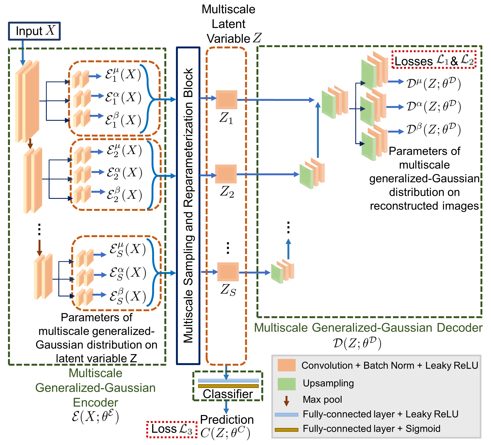
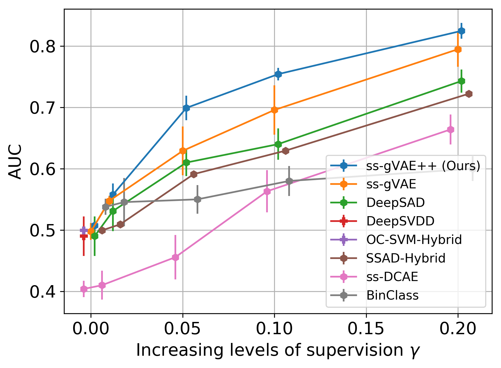
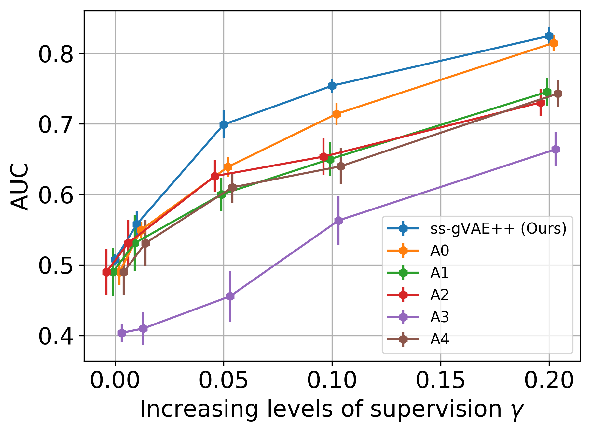
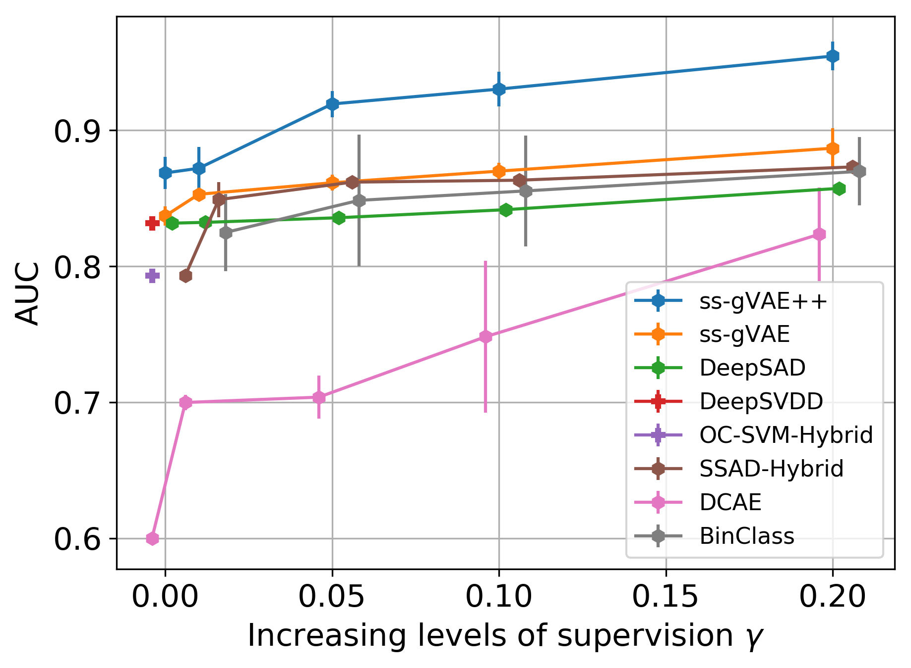
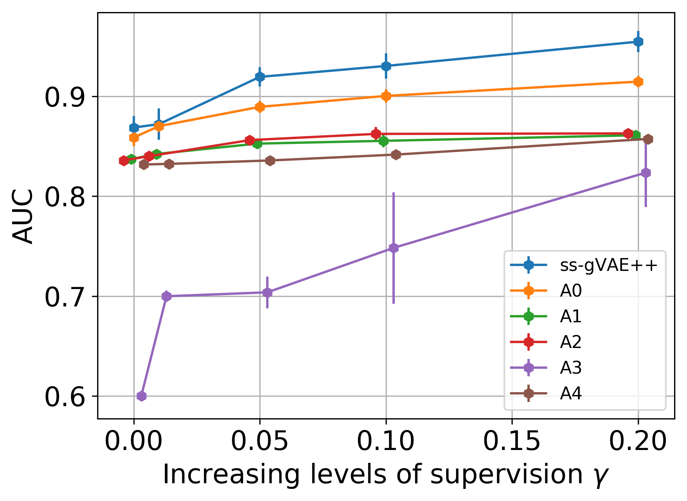
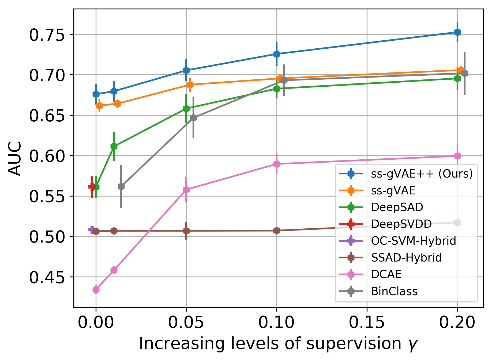
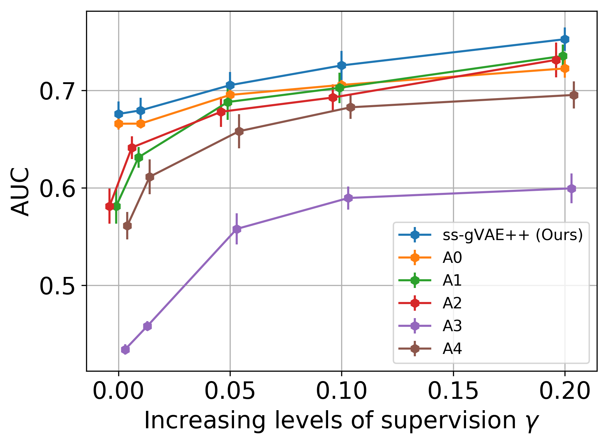
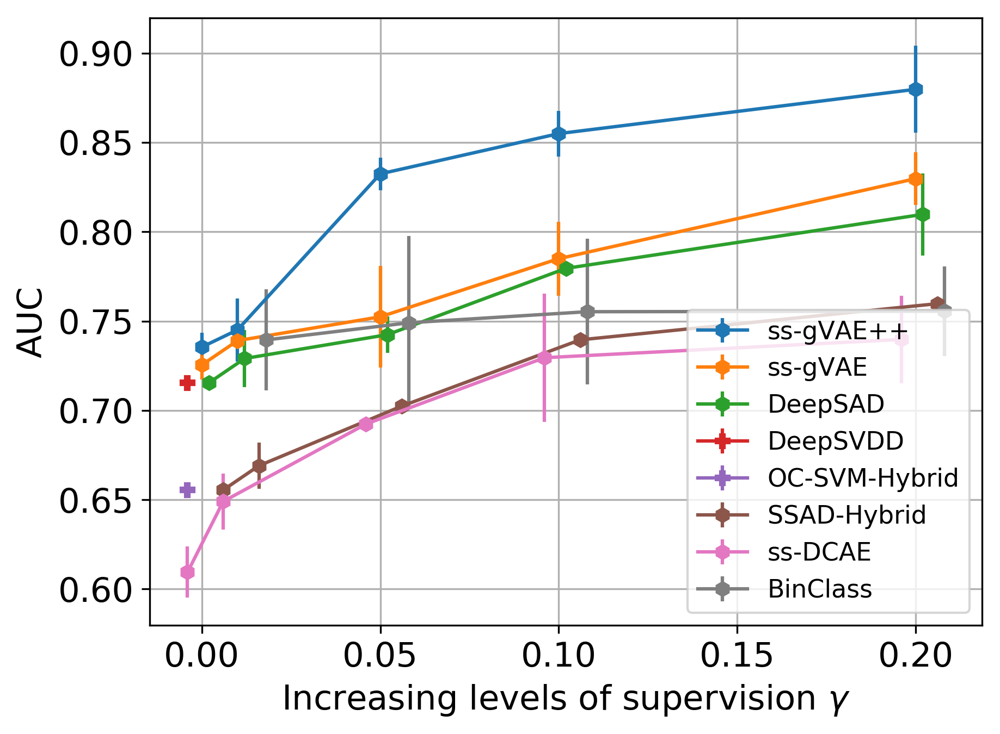
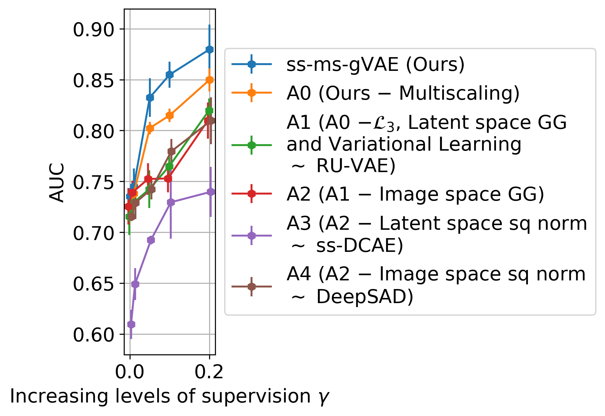

# c-ss-ms-gVAE (Neurocomputing) — thesis Chapter 5

Code for the **semi-supervised multiscale generalized-VAE** experiments in the Neurocomputing paper and PhD thesis Chapter 5.

> This repository is **not** the ss-gVAE (WACV 2022) or RU-VAE / c-ss-gVAE (ISBI 2022) codebase. For those, see [`RenukaSharma/ss-gVAE`](https://github.com/RenukaSharma/ss-gVAE) and [`RenukaSharma/c-ss-gVAE`](https://github.com/RenukaSharma/c-ss-gVAE). A compact map of thesis chapters to repositories is maintained in the ss-gVAE README.

## Paper

- **Neurocomputing (2025):** [A semi-supervised multiscale generalized-VAE framework for one-class classification](https://www.sciencedirect.com/science/article/pii/S092523122401943X)
- **DOI:** [10.1016/j.neucom.2024.129172](https://doi.org/10.1016/j.neucom.2024.129172)

The paper introduces **ms-gVAE** (multiscale generalized VAE), its semi-supervised form **ss-ms-gVAE**, and the latent-space classifier variant **c-ss-ms-gVAE** (the full proposed method).

## Scope of this release

Dataset loaders from the original research tree are kept. The CLI names in `src/main.py` are:

| Dataset (CLI name) | Typical `net_name` | Notes |
|--------------------|--------------------|--------|
| `mvtec` | `mvtec_net` (Stochastic U-Net) | Ten industrial categories; `--category` |
| `malaria_dataset` | `cifar10_LeNet` or `malaria_net` | Cached `.pt` patches under `--data_path` |
| `nanofibre` | `cifar10_LeNet` | ImageFolder `train/` + `test/` |
| `bui_dataset` | `cifar10_LeNet` | Breast ultrasound cached tensors |
| `corrosion` | `cifar10_LeNet` | Used in thesis Ch. 6; loader kept |
| `mnist`, `fmnist`, `cifar10` | `*_LeNet` | Toy / one-vs-rest setups |
| ODDS names (`arrhythmia`, …) | `*_mlp` | Tabular Deep SAD leftovers |

Supporting code lives under `src/` (DeepSAD-style training, SSAD hybrid baseline) and `binary_classifier/` (binary-classifier baseline).

## Results (your figures)

Figures below are the Neurocomputing paper plots (from the Elsevier TeX `pics/` folder), stored in [`docs/figures/`](docs/figures/). They are **not** copied from the ss-gVAE or c-ss-gVAE repositories.

### Method overview

<p align="center">
  
</p>

> **Figure 1.** Semi-supervised multiscale generalized-VAE (c-ss-ms-gVAE) framework for one-class classification. From the Neurocomputing paper.

### MVTec, malaria, nanofibre, breast ultrasound

<p align="center">
  
  &nbsp;
  
</p>

<p align="center">
  
  &nbsp;
  
</p>

<p align="center">
  
  &nbsp;
  
</p>

<p align="center">
  
  &nbsp;
  
</p>

MVTec carpet t-SNE panels from the paper are in [`docs/figures/tsne/`](docs/figures/tsne/).

## Quick start

```bash
export DATA_DIR=$HOME/data/mvtec
export RESULTS_DIR=$HOME/results/c-ss-ms-gvae
./scripts/run_experiment.sh mvtec mvtec_net --category carpet
```

See [`docs/reproducing_paper.md`](docs/reproducing_paper.md) for environment setup, data layout, and more commands. The many `run_*.sh` files in this working tree are local-only (gitignored) and are not published.

## Place in the PhD thesis

This work is **Chapter 5** of the PhD thesis *"Anomaly Detection in Images Using One-class and Multi-class Learning Approaches"* (Renuka Sharma, IITB-Monash Research Academy, 2022).

- Monash Bridges: <https://bridges.monash.edu/articles/thesis/Anomaly_Detection_in_Images_Using_One-class_and_Multi-class_Learning_Approaches/23584503>
- DOI: [`10.26180/23584503`](https://doi.org/10.26180/23584503)

Companion repositories from the same thesis:

| Chapter | Topic | Repository |
| ------- | ----- | ---------- |
| Ch. 3 | ss-gVAE (WACV 2022) | [`ss-gVAE`](https://github.com/RenukaSharma/ss-gVAE) |
| Ch. 4 | RU-VAE (ISBI 2022) | [`c-ss-gVAE`](https://github.com/RenukaSharma/c-ss-gVAE) |
| Ch. 5 | c-ss-ms-gVAE (Neurocomputing) — **this repository** | [`c-ss-ms-gVAE`](https://github.com/RenukaSharma/c-ss-ms-gVAE) (here) |
| Ch. 6 | Anomaly localization (ss-vq-vae) | [`ss-vq-vae`](https://github.com/RenukaSharma/ss-vq-vae) (in preparation) |

## Citation

See [`CITATION.cff`](CITATION.cff) for software metadata and the **preferred citation** to the Neurocomputing paper. If you cite the repository software separately, credit the maintainer listed there.

```bibtex
@article{Sharma2025Neurocomputing,
  title   = {A semi-supervised multiscale generalized-{VAE} framework for one-class classification},
  author  = {Sharma, Renuka and Awate, Suyash P.},
  journal = {Neurocomputing},
  volume  = {620},
  pages   = {129172},
  year    = {2025},
  doi     = {10.1016/j.neucom.2024.129172}
}
```

Scientific authorship for the journal paper is exactly as in the citation above. Assistance with repository preparation, editing, or tooling does **not** constitute co-authorship of the paper.

## License

[MIT](LICENSE). Built upon Deep SAD (Ruff *et al.*, 2020), also MIT-licensed.
